  

  
  
  

### 👋 Hej

I've been modding Minecraft since I was 14. I started with [ProjectKorra](https://projectkorra.com), ran a server on it for two years, and never really stopped building things people can play. Along the way I've consulted for some of the largest Minecraft YouTubers, building custom solutions for their videos. These days I'm tech lead at [Winsty](https://winsty.app) and make small games and server-side mods on the side.

### 🧱 Building

| | |
|---|---|
| **[Dokubolaget](https://github.com/Froosty11/dokubolaget)** | A daily 3×3 grid game built on the Systembolaget product catalog. |
| **Minecraft mods** | Server-side Fabric mods for a community server. |
| **Creator consulting** | Custom-built Minecraft solutions for video productions by some of the biggest creators on YouTube. |
| **[ai-inference-energy-model](https://github.com/Tareg95/ai-inference-energy-model)** | Energy use and carbon impact of AI inference workloads, for a KTH degree thesis. |

### 🛠️ Stack

  
  
  
  
  

### 🐍 Contributions

  <picture>
    <source media="(prefers-color-scheme: dark)" srcset="https://raw.githubusercontent.com/Froosty11/Froosty11/output/snake-dark.svg" />
    
  </picture>

